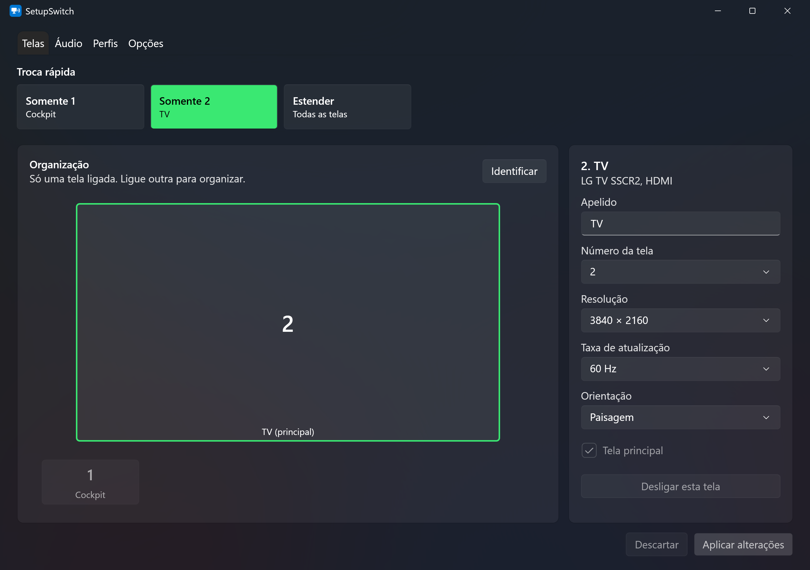
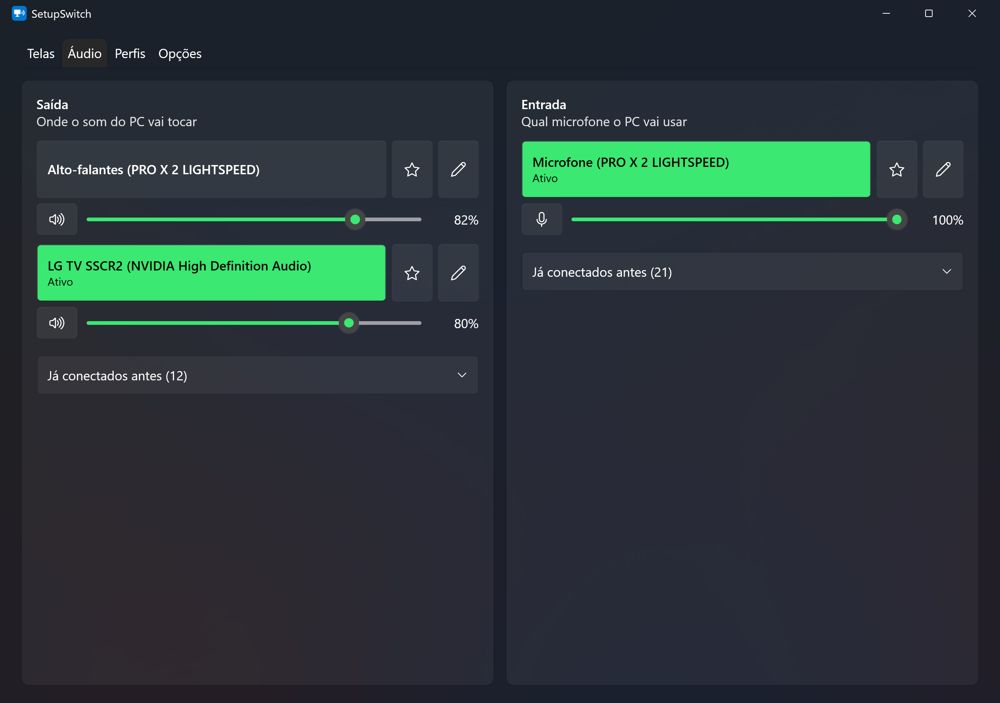

# SetupSwitch

Controle de telas e áudio para Windows 11. Troque com um clique (ou um atalho) qual monitor fica ligado, qual saída de som e qual microfone ficam ativos, e salve combinações como perfis ("Filme na TV", "Trabalho").



## Recursos

- **Telas:** somente uma tela, estender para todas ou qualquer combinação; organizar arrastando, com resolução, taxa, orientação e tela principal.
- **Áudio:** saída e entrada padrão do Windows, com volume e mudo por dispositivo, apelidos, favoritos e lista atualizada sozinha ao conectar um aparelho.
- **Dispositivos já conectados antes:** aparelhos desligados continuam na lista e podem entrar em perfis; ao reconectar, o perfil os reconhece pelo nome, mesmo em outra porta USB.
- **Perfis:** combinações de telas, saída e entrada; cada item pode ficar em "Não alterar". Se faltar um aparelho, o resto é aplicado e um aviso aparece na bandeja.
- **Segurança:** depois de trocar as telas, pede confirmação e volta sozinho em 15 s se ninguém responder.
- **Bandeja e atalhos:** fica perto do relógio e responde a atalhos globais, personalizáveis em **Opções**, inclusive um para cada perfil.

Atalhos de fábrica:

| Atalho | Ação |
|---|---|
| `Ctrl+Alt+1`, `2`, `3`... | Somente aquela tela |
| `Ctrl+Alt+E` | Estender |
| `Ctrl+Alt+0` | Desfazer a última troca de telas |



## Requisitos

- Windows 11 (deve funcionar no Windows 10, não testado)
- [.NET 10 Desktop Runtime](https://dotnet.microsoft.com/download/dotnet/10.0) para executar; o .NET 10 SDK para compilar

## Compilar

```bash
bash publicar.sh
```

Gera `publish/SetupSwitch.exe` (app) e `publish/SetupSwitchCli.exe` (linha de comando).

## Estrutura

| Projeto | Função |
|---|---|
| `SetupSwitch.Core` | Telas, pela API CCD do Windows (`QueryDisplayConfig` / `SetDisplayConfig`), e perfis |
| `SetupSwitch.Audio` | Áudio e volume, pela Core Audio API |
| `SetupSwitch.App` | Interface WPF, bandeja, atalhos e confirmação |
| `SetupSwitch.Cli` | Comandos de terminal para testes |

As configurações ficam em `%LOCALAPPDATA%\SetupSwitch`.

## Limitações conhecidas

- **Trocar o dispositivo de áudio padrão usa a interface não documentada `IPolicyConfig`**, a mesma usada por outros programas do tipo. Uma atualização do Windows pode quebrá-la; o código fica isolado em `SetupSwitch.Audio/Native/PolicyConfig.cs`.
- **Replicar a imagem nas 3 telas não é suportado:** com as telas testadas, o Windows recusou qualquer réplica que incluísse a TV.
- Programas configurados com um dispositivo de áudio próprio podem ignorar a troca do padrão do Windows.
